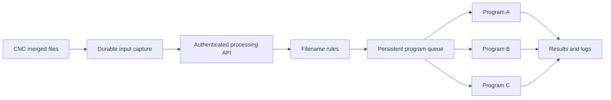

# CNC File Processing API Blueprint

Status: design proposal; the processor described here has not been implemented.

## Instructions for the next AI

Work only on the standalone `cnc-processor` project and this supplied blueprint. Do not read, modify, check out, or deploy the main CNC repository. Do not request expanded access to CNC. Treat CNC as an external HTTP client and use a mock client for development and verification.

If your workspace contains only this document, you can improve the design there. Implementation requires a separate `cnc-processor` folder or repository containing a copy of this blueprint; it does not require access to CNC. Follow instructions applicable to that separate project.

The CNC maintainer owns all CNC changes in a separate integration task. Your deliverable is the processor, its documented API contract, and a mock client. Preserve the agreed behavior: a separate service on the same server, processing new complete lines, with independent programs receiving the same input. The hidden integration panel is a proposed default, not a confirmed user choice.

Focus improvements on durable batch acceptance, queue recovery, API authentication, and simple standalone deployment. Identify gaps and unresolved decisions, explain proposed changes, and update this document before implementation. Do not assume program commands, filenames, input formats, or authorization to run production programs. Do not expose credentials or overwrite unrelated local changes.

Pay particular attention to atomic batch acceptance and job creation, pause behavior, duplicate requests, and retries of programs with external side effects. Distinguish durable input delivery from exactly-once program execution. Source-file capture and Google Drive deletion safety are external integration responsibilities, not work for this project.

## Summary

Create a separate Go project, `cnc-processor`, running beside CNC on `127.0.0.1:9191`.



Process newly added, complete lines continuously. Programs matching the same filename receive independent copies of the input. Everything runs on the cloud server; processing does not require the user's computer or a local SSH tunnel.

## External CNC responsibilities — context only

The CNC maintainer will implement and verify the following separately. The processor AI must not implement these changes or inspect CNC to validate them.

- CNC captures new lines from `~/merged` every 2 seconds, with immediate notifications after its own writes.
- Store captured batches in a persistent CNC outbox before delivery. Include batch ID, source filename, file generation, and line positions.
- Centralize existing merged-file writes through one helper. Capture pending content before a file is replaced or deleted, including Google Drive cleanup.
- Ignore directories, symlinks, and hidden files. Hold unfinished lines until their terminating newline arrives.
- On first enable, capture existing complete lines once. File replacement or truncation starts a new generation.
- Retry undelivered batches after API outages. Remove an outbox batch only after the API confirms durable acceptance.
- Repeated delivery of the same batch must return the original acceptance result without creating duplicate jobs.

This separates processing input from Google Drive's upload and deletion lifecycle. File capture belongs to CNC in this proposed design; the separate API receives durable filename-labelled batches and applies processing rules.

## Self-contained client contract

The processor receives complete line records over HTTP. It never opens CNC's merged directory or requires access to CNC settings, Google credentials, or source code. `127.0.0.1:9191` refers to the cloud server's loopback interface; the user's computer is not part of runtime processing.

Example `POST /v1/batches` body, usable by the mock client:

```json
{
  "source_id": "demo-client",
  "batch_id": "batch-0001",
  "filename": "example.txt",
  "generation": "generation-0001",
  "records": [
    {"offset": 0, "line": "example-entry"}
  ]
}
```

- Require `Authorization: Bearer <shared-secret>` on every endpoint.
- `source_id` identifies the sender; `batch_id` is a sender-generated stable ID reused on retries. Deduplicate by their pair, not by line content.
- `filename` is a basename used for exact rule matching, never an executable or filesystem path. Reject path separators and invalid names.
- `generation` is an opaque sender-generated file-generation ID. `offset` is the nonnegative byte position of the line within that generation. These are source metadata; the processor does not inspect the file.
- `line` is a UTF-8 string without CR/LF terminators or embedded newlines. Preserve record order and add newline terminators when writing program input. Repeated content in distinct batches is processed as separate arrivals.
- Atomically persist the batch, its payload fingerprint, the selected rule version, and one independent job per matching program before acknowledging acceptance. Snapshot execution configuration so later rule edits do not silently change queued jobs.
- Return `202` with `acceptance_id`, `batch_id`, and `run_ids` after durable acceptance. An identical retry returns the same identifiers without new jobs; reuse of the same key with a different payload returns `409`.
- Accept unmatched filenames durably with an empty `run_ids` list and an explicit `unmatched` indicator; expose this outcome so configuration mistakes are visible.
- Return a failure without an acceptance acknowledgment when persistence fails. The sender retains its batch until acknowledgment.
- Define validation limits, error bodies, and all response schemas in the project's OpenAPI document before implementation. Treat this draft contract as the shared boundary; document proposed changes for the CNC maintainer rather than editing CNC.

## Separate API and program execution

Use SQLite through [modernc.org/sqlite](https://pkg.go.dev/modernc.org/sqlite) for accepted batches, program runs, attempts, and results.

| Endpoint | Purpose |
|---|---|
| `GET /v1/health` | Report service readiness and queue counts |
| `POST /v1/batches` | Durably accept filename-labelled input; return an acceptance ID |
| `PUT /v1/processing-state` | Persist `{ "enabled": true/false }` and report effective scheduler state |
| `GET /v1/runs` | List queued, running, completed, and failed executions |
| `GET /v1/runs/{id}` | Retrieve status, attempts, logs, and output references |
| `POST /v1/runs/{id}/retry` | Explicitly retry a failed execution |

- Authenticate every endpoint with a shared bearer secret. Accept input batches, not executable commands, through the API.
- Define routing in a private configuration file: exact filename to program IDs.
- Define each program separately using an absolute executable path, argument array, timeout, and concurrency limit.
- Supply newline-delimited input through a temporary file referenced by `{input_file}`. Execute argument arrays directly without shell interpolation.
- Suggested sender batching: 100 lines or 2 seconds, whichever arrives first; the mock sender demonstrates this without watching CNC files.
- Default execution limits: 4 programs globally, 1 execution per program, and a 5-minute timeout.
- Each program succeeds or fails independently. Program failures require manual retry by default; explicitly retry-safe programs may enable automatic retries.
- Persist output and logs outside `~/merged`, preventing processing loops.
- Interrupted executions become `interrupted` after restart; do not claim exactly-once execution of programs with external side effects.

Example behavior: new lines in a configured file are saved to the queue and supplied independently to Program A and Program B. If B fails, A's successful result remains saved. This is an illustrative example, not a production routing rule.

## Processor pause behavior and deployment

- `PUT /v1/processing-state` is idempotent. Persist the requested state before acknowledging it and restore it after restart. Default a new installation to paused.
- While paused, accept and durably queue incoming batches but start no new executions. Running programs finish; resume starts eligible queued jobs.
- Return the effective state from the control endpoint and health response. Serialize scheduler starts with pause changes so no new job starts after a pause acknowledgment.
- Generate the shared secret during installation and store it outside Git with restricted permissions. Never include real credentials in fixtures, examples, logs, or this document.
- Provide a separate systemd service under a dedicated service account, bound to loopback on port 9191.
- Keep configuration, database, input, output, and logs outside the Git checkout. Preserve them on redeploy. No access to CNC files is required by the service account.
- Supply deployment instructions and artifacts; do not deploy to production or run real programs without a separate instruction.

## Future CNC integration — owned by the CNC maintainer

These are requirements for a later CNC task, not instructions to the standalone-project AI.


- Add a hidden Processor integration panel, exposed only when the server feature flag `processor_feature_enabled` is set.
- Provide Enable, connection status, queue counts, recent failures, and an Advanced section for endpoint and secret settings.
- Keep existing dashboard access controls. Hiding the panel does not replace authentication.
- Toggle OFF stops CNC capture and delivery and requests processor pause through the control endpoint. Display pause as confirmed only after acknowledgment; if the API is unreachable, show pending/unknown because the remote scheduler may still be running. Running programs finish and queued work remains preserved.
- Toggle ON resumes queued work and captures available unprocessed lines.
- Configure CNC with the processor endpoint and shared secret through its own protected configuration. Preserve CNC settings and its outbox across redeploys.

## Standalone verification and handoff

Use a mock HTTP sender and two harmless fixture programs in the separate project. No CNC checkout, dashboard, cloud credentials, Google account, or production access is needed.

Verify durable acceptance, duplicate retries and conflicting payloads, unmatched filenames, restart recovery, pause/resume persistence, unauthorized requests, invalid input, program failures, timeouts, and concurrency limits. Confirm a failed program does not rerun a successful sibling. Simulate persistence failure and verify no success acknowledgment is issued. Verify credentials are redacted.

Deliver:

- The standalone Go service and example configuration containing fixture rules only.
- An OpenAPI contract, mock sender, and reproducible fixture-based tests.
- A README with local startup, authentication, batch submission, pause/resume, status inspection, and recovery instructions.
- A systemd unit and deployment instructions explaining persistent data paths and secret provisioning.
- A short integration handoff describing required CNC calls and outstanding external assumptions, without CNC patches.

The CNC maintainer separately tests partial lines, concurrent appends, existing-file import, truncation, outages, toggle delivery, and Google Drive deletion before acknowledgment. Passing standalone tests does not establish these end-to-end capture guarantees.

## Assumptions and decisions to resolve before implementation

Confirmed by the user:

- The API runs on the same server in a separate project or folder.
- Processing consumes new lines rather than rerunning entire files.
- Multiple programs run independently against the same input.

Proposed defaults:

- The next AI builds only the separate API; CNC integration is a separate task owned by the CNC maintainer.
- The integration is hidden behind a feature flag.
- Matching uses exact filenames; program mappings are supplied through configuration.
- Ship with fixture rules only, with no production programs enabled until their commands and input formats are provided.

The next design pass should resolve:

- Concrete filename/program mappings, required arguments, input formats, and output expectations.
- Whether “secret feature” means a hidden panel or simply an authenticated integration.
- External CNC decision: crash recovery between merged-file changes and outbox commits, including all write and replacement paths. Leave this to the CNC maintainer.
- External CNC decision: whether files created and deleted while the integration is disabled should be processed later. Current wording promises recovery only of queued work and input still available on re-enable.
- Queue and log storage limits, retention, disk-full behavior, and program timeout/process cleanup.
- How long acceptance IDs and payload fingerprints are retained so delayed retries remain deduplicated. Define retention together with the external sender retry horizon.

## Workspace boundary

Give the next AI this document in a separate `cnc-processor` workspace. It must build against the HTTP contract using its mock sender and must never require the main CNC source tree. If a CNC implementation detail is unknown, record an external assumption or a question for the CNC maintainer instead of requesting access.

Do not treat this blueprint as evidence that the processor, CNC integration, or deployment has already been completed.
